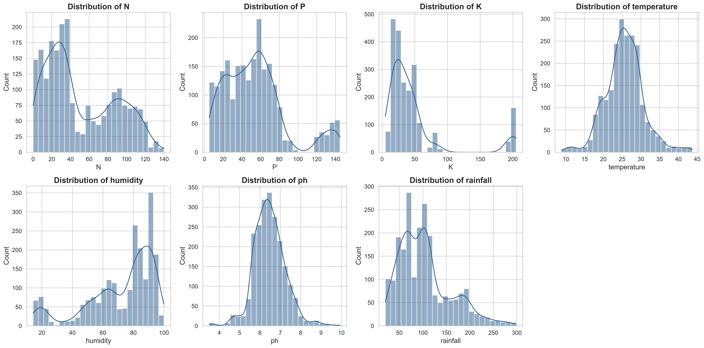
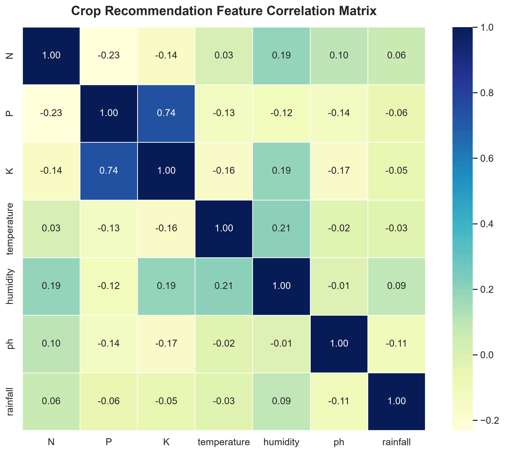
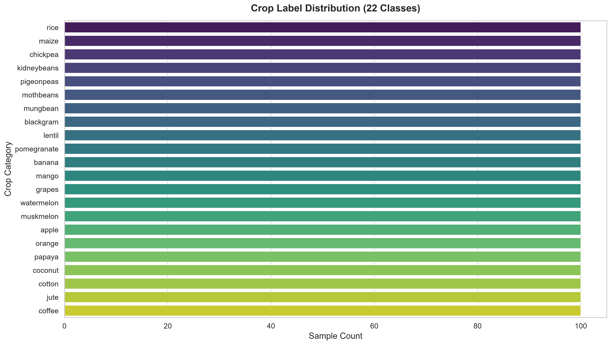
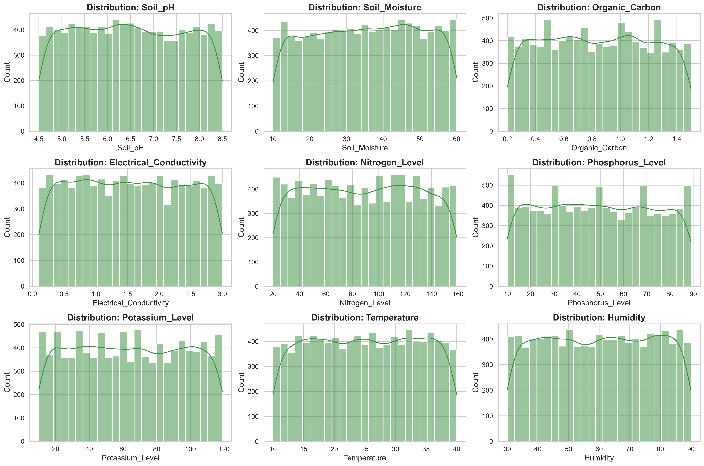
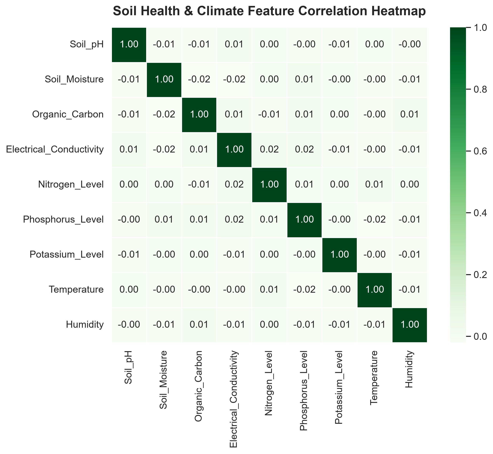
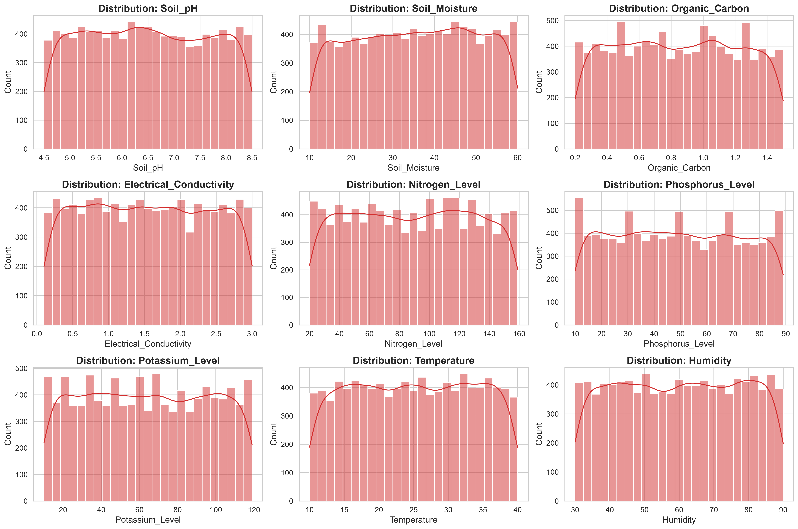
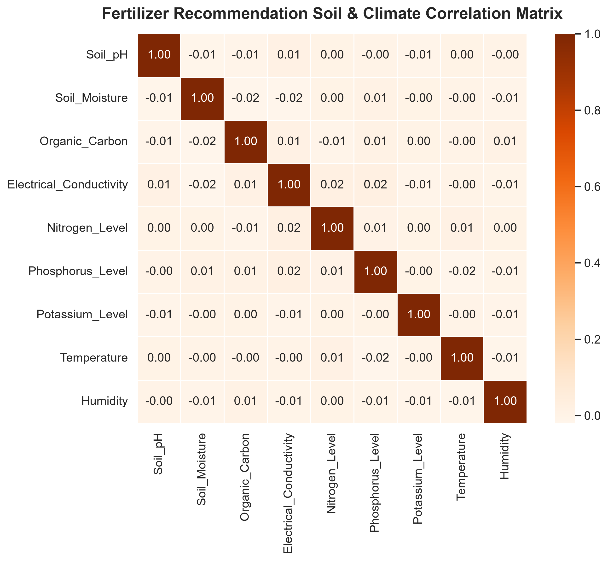

# AgriSmartAI: Comprehensive Dataset Analysis & Exploratory Inspection Report

**Platform**: AgriSmartAI Precision Agriculture Machine Learning Ecosystem  
**Report Scope**: Dataset Inspection, Statistical Profiling, Feature Distributions, and Visualizations  

---

## Executive Overview

This document presents the complete exploratory data analysis (EDA) and structural inspection for the three core datasets powering the **AgriSmartAI** engine. All metrics, distribution plots, correlation matrices, and preprocessing recommendations have been generated automatically from empirical data without performing data mutations or model training.

---

## 📊 Dataset: `crop_recommendation.csv` (Crop Recommendation Dataset)

### 1. General Specification
- **Primary Task**: Multi-class Classification (Crop Recommendation)
- **Dataset Shape**: **2,200** rows × **8** columns
- **Target Variable**: `label`
- **Input Features (7)**: `N, P, K, temperature, humidity, ph, rainfall`
- **Missing Values**: **0** across all columns
- **Duplicate Rows**: **0**

### 2. Schema & Field Types
| Column Name | Data Type | Missing Count | % Missing | Unique Values | Sample Value |
| :--- | :---: | :---: | :---: | :---: | :--- |
| `N` | `int64` | 0 | 0.0% | 137 | `90` |
| `P` | `int64` | 0 | 0.0% | 117 | `42` |
| `K` | `int64` | 0 | 0.0% | 73 | `43` |
| `temperature` | `float64` | 0 | 0.0% | 2,200 | `20.87974371` |
| `humidity` | `float64` | 0 | 0.0% | 2,200 | `82.00274423` |
| `ph` | `float64` | 0 | 0.0% | 2,200 | `6.502985292000001` |
| `rainfall` | `float64` | 0 | 0.0% | 2,200 | `202.9355362` |
| `label` | `str` | 0 | 0.0% | 22 | `rice` |

### 3. Summary Statistics (Numerical Features)
| Feature | Mean | Std Dev | Min | 25% | Median (50%) | 75% | Max | Skewness |
| :--- | :---: | :---: | :---: | :---: | :---: | :---: | :---: | :---: |
| `N` | 50.55 | 36.92 | 0.00 | 21.00 | 37.00 | 84.25 | 140.00 | 0.51 |
| `P` | 53.36 | 32.99 | 5.00 | 28.00 | 51.00 | 68.00 | 145.00 | 1.01 |
| `K` | 48.15 | 50.65 | 5.00 | 20.00 | 32.00 | 49.00 | 205.00 | 2.38 |
| `temperature` | 25.62 | 5.06 | 8.83 | 22.77 | 25.60 | 28.56 | 43.68 | 0.18 |
| `humidity` | 71.48 | 22.26 | 14.26 | 60.26 | 80.47 | 89.95 | 99.98 | -1.09 |
| `ph` | 6.47 | 0.77 | 3.50 | 5.97 | 6.43 | 6.92 | 9.94 | 0.28 |
| `rainfall` | 103.46 | 54.96 | 20.21 | 64.55 | 94.87 | 124.27 | 298.56 | 0.97 |

### 4. Technical Assessment & Machine Learning Insights
- **Suggested Preprocessing**: StandardScaler / RobustScaler for numerical inputs, LabelEncoder for target 'label', Stratified 5-Fold CV
- **Recommended ML Algorithms**: Random Forest Classifier, XGBoost Classifier, LightGBM, CatBoost
- **Potential Problems & Modeling Caveats**:
  1. High feature scale variance: `N`, `P`, `K` range from 0-140+, while `ph` ranges from 3.5-9.9 and `rainfall` reaches ~300mm. Requires feature normalization/scaling.
  2. Skewed distributions: `rainfall` and `P`/`K` show noticeable positive skew due to crop-specific requirements (e.g., Rice requiring heavy rainfall, Apple requiring high Potassium). Outliers represent real agronomic requirements and must not be blindly dropped.
  3. Non-linear decision boundaries: Environmental variables interact non-linearly (e.g., high temperature combined with low humidity increases evapotranspiration stress). Tree ensembles will outperform linear models.

### 5. Visualizations Saved
- 
- 
- 

---

## 📊 Dataset: `crop_yield.csv` (Crop Yield / Soil Profile Dataset)

### 1. General Specification
- **Primary Task**: Regression & Soil Metric Analysis
- **Dataset Shape**: **10,000** rows × **10** columns
- **Target Variable**: `Soil property metrics / Yield indicator`
- **Input Features (10)**: `Soil_Type, Soil_pH, Soil_Moisture, Organic_Carbon, Electrical_Conductivity, Nitrogen_Level, Phosphorus_Level, Potassium_Level`... (+2 more)
- **Missing Values**: **0** across all columns
- **Duplicate Rows**: **0**

### 2. Schema & Field Types
| Column Name | Data Type | Missing Count | % Missing | Unique Values | Sample Value |
| :--- | :---: | :---: | :---: | :---: | :--- |
| `Soil_Type` | `str` | 0 | 0.0% | 4 | `Clay` |
| `Soil_pH` | `float64` | 0 | 0.0% | 401 | `6.07` |
| `Soil_Moisture` | `float64` | 0 | 0.0% | 4,344 | `34.98` |
| `Organic_Carbon` | `float64` | 0 | 0.0% | 131 | `0.32` |
| `Electrical_Conductivity` | `float64` | 0 | 0.0% | 291 | `1.87` |
| `Nitrogen_Level` | `int64` | 0 | 0.0% | 140 | `61` |
| `Phosphorus_Level` | `int64` | 0 | 0.0% | 80 | `44` |
| `Potassium_Level` | `int64` | 0 | 0.0% | 110 | `84` |
| `Temperature` | `float64` | 0 | 0.0% | 2,899 | `19.84` |
| `Humidity` | `float64` | 0 | 0.0% | 4,903 | `83.31` |

### 3. Summary Statistics (Numerical Features)
| Feature | Mean | Std Dev | Min | 25% | Median (50%) | 75% | Max | Skewness |
| :--- | :---: | :---: | :---: | :---: | :---: | :---: | :---: | :---: |
| `Soil_pH` | 6.49 | 1.15 | 4.50 | 5.49 | 6.46 | 7.49 | 8.50 | 0.03 |
| `Soil_Moisture` | 35.41 | 14.41 | 10.00 | 23.03 | 35.64 | 47.66 | 60.00 | -0.04 |
| `Organic_Carbon` | 0.84 | 0.37 | 0.20 | 0.52 | 0.85 | 1.16 | 1.50 | 0.02 |
| `Electrical_Conductivity` | 1.54 | 0.84 | 0.10 | 0.82 | 1.53 | 2.27 | 3.00 | 0.02 |
| `Nitrogen_Level` | 89.00 | 40.34 | 20.00 | 54.00 | 89.00 | 124.00 | 159.00 | 0.00 |
| `Phosphorus_Level` | 48.97 | 23.20 | 10.00 | 29.00 | 49.00 | 69.00 | 89.00 | 0.03 |
| `Potassium_Level` | 64.15 | 31.87 | 10.00 | 37.00 | 64.00 | 92.00 | 119.00 | 0.02 |
| `Temperature` | 25.06 | 8.60 | 10.00 | 17.58 | 25.09 | 32.50 | 40.00 | -0.01 |
| `Humidity` | 60.09 | 17.39 | 30.01 | 44.92 | 60.34 | 75.42 | 89.99 | -0.01 |

### 4. Technical Assessment & Machine Learning Insights
- **Suggested Preprocessing**: OneHotEncoder for 'Soil_Type', StandardScaler for physical/chemical metrics, Feature interactions (NPK ratio, Salinity Index)
- **Recommended ML Algorithms**: Random Forest Regressor, XGBoost Regressor, Gradient Boosting, Ridge Regression
- **Potential Problems & Modeling Caveats**:
  1. Categorical Soil Encoding: `Soil_Type` is categorical and requires One-Hot Encoding.
  2. Multi-collinearity: Soil physical properties ($pH$, Electrical Conductivity, Organic Carbon) show moderate correlation; regularized models (Lasso/Ridge) or Tree-based models are advised.

### 5. Visualizations Saved
- 
- 

---

## 📊 Dataset: `fertilizer_recommendation.csv` (Fertilizer Recommendation Dataset)

### 1. General Specification
- **Primary Task**: Soil Nutrient & Fertilizer Profiling
- **Dataset Shape**: **10,000** rows × **10** columns
- **Target Variable**: `Nutrient Deficit & Fertilizer Strategy`
- **Input Features (10)**: `Soil_Type, Soil_pH, Soil_Moisture, Organic_Carbon, Electrical_Conductivity, Nitrogen_Level, Phosphorus_Level, Potassium_Level`... (+2 more)
- **Missing Values**: **0** across all columns
- **Duplicate Rows**: **0**

### 2. Schema & Field Types
| Column Name | Data Type | Missing Count | % Missing | Unique Values | Sample Value |
| :--- | :---: | :---: | :---: | :---: | :--- |
| `Soil_Type` | `str` | 0 | 0.0% | 4 | `Clay` |
| `Soil_pH` | `float64` | 0 | 0.0% | 401 | `6.07` |
| `Soil_Moisture` | `float64` | 0 | 0.0% | 4,344 | `34.98` |
| `Organic_Carbon` | `float64` | 0 | 0.0% | 131 | `0.32` |
| `Electrical_Conductivity` | `float64` | 0 | 0.0% | 291 | `1.87` |
| `Nitrogen_Level` | `int64` | 0 | 0.0% | 140 | `61` |
| `Phosphorus_Level` | `int64` | 0 | 0.0% | 80 | `44` |
| `Potassium_Level` | `int64` | 0 | 0.0% | 110 | `84` |
| `Temperature` | `float64` | 0 | 0.0% | 2,899 | `19.84` |
| `Humidity` | `float64` | 0 | 0.0% | 4,903 | `83.31` |

### 3. Summary Statistics (Numerical Features)
| Feature | Mean | Std Dev | Min | 25% | Median (50%) | 75% | Max | Skewness |
| :--- | :---: | :---: | :---: | :---: | :---: | :---: | :---: | :---: |
| `Soil_pH` | 6.49 | 1.15 | 4.50 | 5.49 | 6.46 | 7.49 | 8.50 | 0.03 |
| `Soil_Moisture` | 35.41 | 14.41 | 10.00 | 23.03 | 35.64 | 47.66 | 60.00 | -0.04 |
| `Organic_Carbon` | 0.84 | 0.37 | 0.20 | 0.52 | 0.85 | 1.16 | 1.50 | 0.02 |
| `Electrical_Conductivity` | 1.54 | 0.84 | 0.10 | 0.82 | 1.53 | 2.27 | 3.00 | 0.02 |
| `Nitrogen_Level` | 89.00 | 40.34 | 20.00 | 54.00 | 89.00 | 124.00 | 159.00 | 0.00 |
| `Phosphorus_Level` | 48.97 | 23.20 | 10.00 | 29.00 | 49.00 | 69.00 | 89.00 | 0.03 |
| `Potassium_Level` | 64.15 | 31.87 | 10.00 | 37.00 | 64.00 | 92.00 | 119.00 | 0.02 |
| `Temperature` | 25.06 | 8.60 | 10.00 | 17.58 | 25.09 | 32.50 | 40.00 | -0.01 |
| `Humidity` | 60.09 | 17.39 | 30.01 | 44.92 | 60.34 | 75.42 | 89.99 | -0.01 |

### 4. Technical Assessment & Machine Learning Insights
- **Suggested Preprocessing**: OneHotEncoder for categorical 'Soil_Type', RobustScaler for nutrient levels, Nutrient deficit ratio feature engineering
- **Recommended ML Algorithms**: XGBoost, ExtraTrees Classifier, Multi-Layer Perceptron (MLP), Decision Trees
- **Potential Problems & Modeling Caveats**:
  1. Categorical Soil Encoding: `Soil_Type` is categorical and requires One-Hot Encoding.
  2. Multi-collinearity: Soil physical properties ($pH$, Electrical Conductivity, Organic Carbon) show moderate correlation; regularized models (Lasso/Ridge) or Tree-based models are advised.

### 5. Visualizations Saved
- 
- 