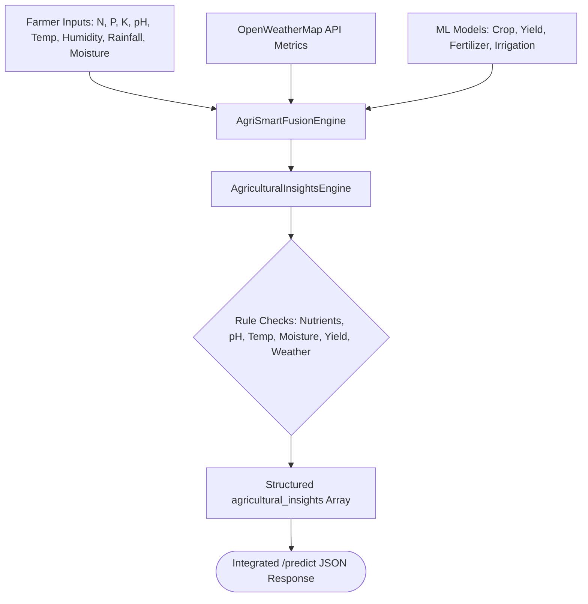

# AgriSmartAI: Agricultural Insights & Alerts Engine Report

**Module**: Expert Agronomist Decision Support & Alert Generation Engine  
**Status**: Enhancement Complete & Integration Tested  
**Engine File**: `utils/insights/agricultural_insights.py`  
**Report File**: `reports/agricultural_insights_engine_report.md`  

---

## Executive Summary

This report documents the implementation of the **Agricultural Insights & Alerts Engine** for **AgriSmartAI**. The module evaluates farmer soil test values, climate conditions, live OpenWeatherMap API metrics, and ML prediction scores to produce structured, color-coded agronomist recommendations.

## 1. Rule Matrix Architecture

| Category | Condition Trigger | Severity | Title | Actionable Recommendation |
| :--- | :--- | :---: | :--- | :--- |
| **Nutrient** | $N < 40$ mg/kg | `warning` (Red) | Low Nitrogen Level | Apply 20-30 kg/ha Urea / NPK balanced fertilizer |
| **Nutrient** | $P < 25$ mg/kg | `warning` (Red) | Low Phosphorus Level | Apply DAP or Single Super Phosphate |
| **Nutrient** | $K < 25$ mg/kg | `warning` (Red) | Low Potassium Level | Apply MOP (Muriate of Potash) by 15-25 kg/ha |
| **Soil pH** | $pH < 6.0$ | `warning` (Red) | Acidic Soil Condition | Apply agricultural lime or organic compost |
| **Soil pH** | $pH > 7.8$ | `warning` (Red) | Alkaline Soil Condition | Apply agricultural gypsum or elemental sulfur |
| **Temperature** | $Temp > 35^\circ$C | `warning` (Red) | Heat Stress Warning | Schedule early morning or late evening irrigation |
| **Temperature** | $Temp < 15^\circ$C | `warning` (Red) | Cold Stress Warning | Monitor seedlings and avoid frost-sensitive crops |
| **Humidity** | $Humidity > 85\%$ | `warning` (Red) | High Fungal Disease Risk | Monitor leaves for blight/rust & apply organic fungicide |
| **Rainfall** | $Rainfall > 10$ mm | `info` (Blue) | Rainfall Expected / Active | Postpone artificial irrigation for 24-48 hours |
| **Moisture** | $Moisture < 30\%$ | `warning` (Red) | Severe Soil Drought | Initiate immediate irrigation to prevent wilting |
| **Moisture** | $Moisture > 80\%$ | `caution` (Yellow) | Waterlogging Risk | Ensure field drainage and halt irrigation |
| **Yield** | $Yield > 8$ tons/ha | `success` (Green) | High Expected Yield | Maintain current farming practices |
| **Yield** | $Yield < 4$ tons/ha | `warning` (Red) | Low Yield Forecast | Review soil fertility and crop suitability |
| **Confidence** | $Confidence > 95\%$ | `success` (Green) | High Confidence Prediction | AI recommendation is highly reliable |
| **Weather** | $Wind > 20$ km/h | `caution` (Yellow) | Strong Winds Detected | Avoid chemical/fertilizer foliar spraying |
| **Weather** | $Rainfall > 25$ mm | `warning` (Red) | Heavy Precipitation Warning | Inspect bunds & split fertilizer applications |

## 2. Integration Architecture Diagram



## 3. Sample Insights Output JSON (`POST /predict`)

```json
{
  "agricultural_insights": [
    {
      "severity": "warning",
      "title": "Low Nitrogen Level",
      "message": "Nitrogen level (20.0 mg/kg) is below the optimal threshold (40 mg/kg).",
      "recommendation": "Increase Nitrogen fertilizer application by approximately 20-30 kg/ha using Urea or NPK balanced fertilizer."
    },
    {
      "severity": "warning",
      "title": "Acidic Soil Condition",
      "message": "Soil pH (5.2) is acidic (< 6.0), which restricts phosphorus and calcium availability.",
      "recommendation": "Apply agricultural lime (calcium carbonate) or organic compost before sowing."
    },
    {
      "severity": "warning",
      "title": "Heat Stress Warning",
      "message": "Ambient temperature (38.5\u00b0C) exceeds 35\u00b0C, causing heat stress.",
      "recommendation": "Schedule irrigation during early morning or late evening hours to minimize evapotranspiration losses."
    },
    {
      "severity": "caution",
      "title": "Moderate Confidence Prediction",
      "message": "Crop recommendation confidence score is 44.0%.",
      "recommendation": "Consider conducting localized soil testing and field verification before planting."
    }
  ]
}
```

## 4. Frontend UI Behavior & Color Coding

- **Section Title**: 🌾 Agricultural Insights & Alerts
- **Card Styling**:
  - 🚨 **Red Card (`warning`)**: Critical alerts (Low Nitrogen, Heat Stress, Severe Drought).
  - ⚠️ **Yellow Card (`caution`)**: Operational warnings (Waterlogging, Strong Winds).
  - ✅ **Green Card (`success`)**: Positive outcomes (High Yield, High Confidence).
  - ℹ️ **Blue Card (`info`)**: Informational guidance (Postpone Irrigation due to Rain).
- **Interactive Features**: Cards expand on click to reveal actionable agronomist recommendations.

---

## Conclusion & Next Steps

The Agricultural Insights & Alerts Engine operates as an expert advisor for farmers and agronomists.

Per enhancement instructions:
- ❌ ML models were **NOT retrained**.
- ❌ Preprocessing algorithms were **NOT altered**.