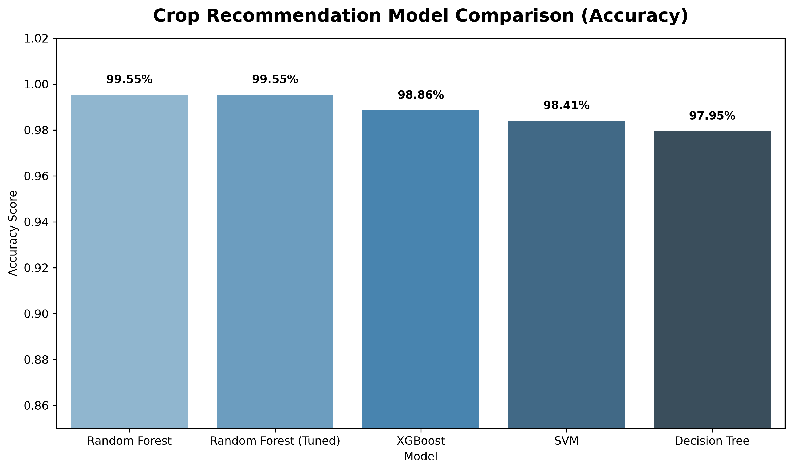
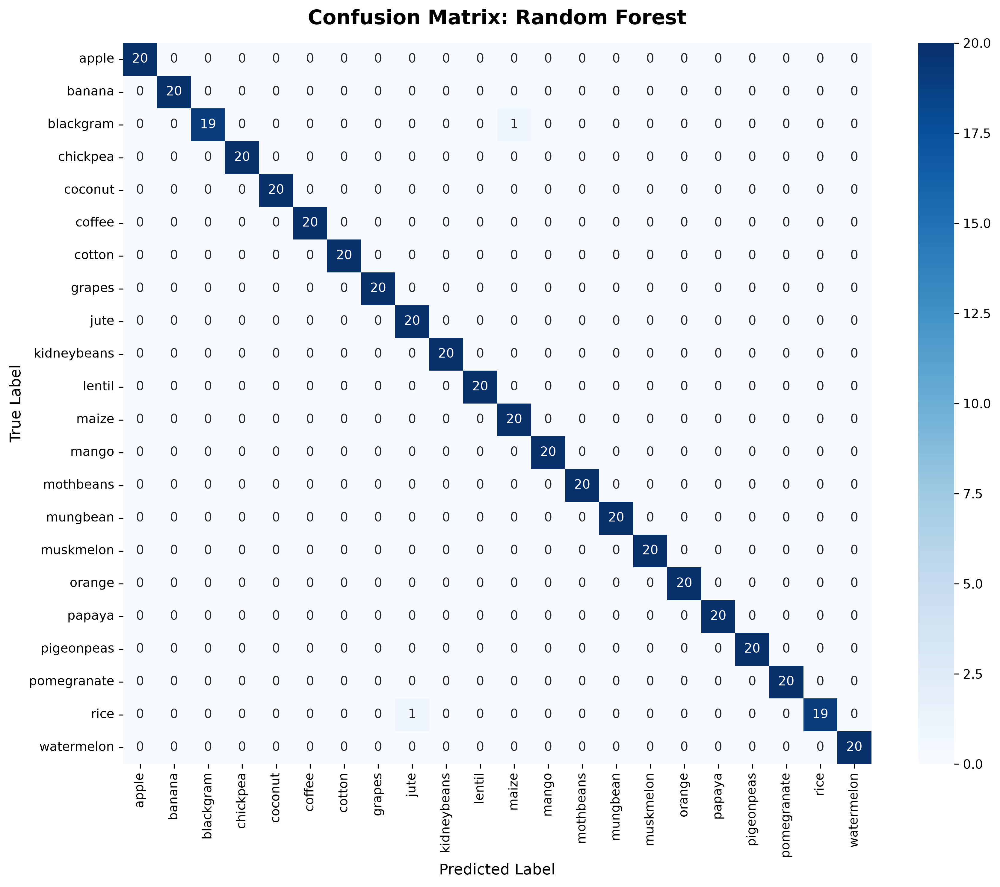
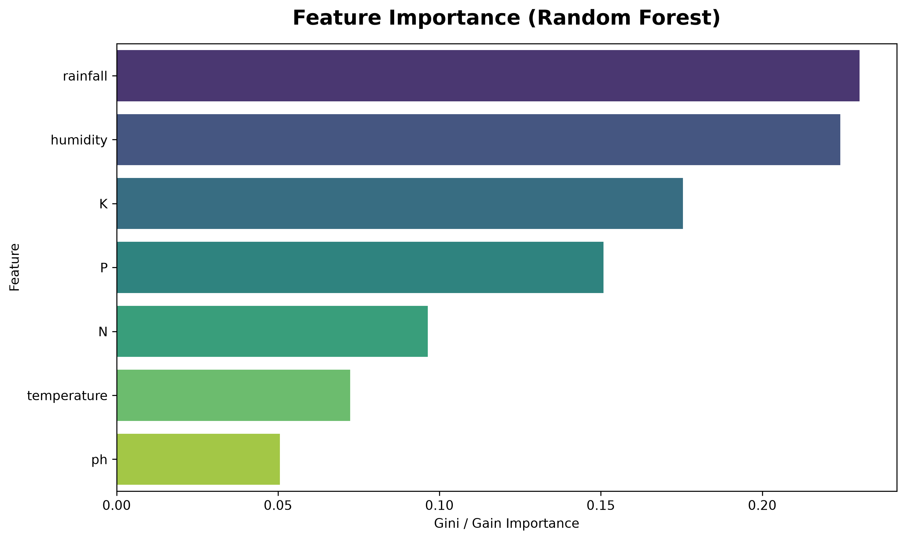

# AgriSmartAI: Crop Recommendation Machine Learning Report

**Module**: Crop Recommendation Engine  
**Status**: Phase 3 Model Training & Benchmark Completed  
**Winning Model**: Random Forest  
**Model Artifact**: `models/crop_recommendation_model.pkl`  

---

## Executive Summary

This report presents the machine learning benchmark and evaluation for the **AgriSmartAI Crop Recommendation System**. Four distinct classification algorithms—**Decision Tree**, **Random Forest**, **Support Vector Machine (SVM)**, and **XGBoost**—were trained and benchmarked on an 80:20 stratified split of 2,200 agricultural samples across 22 crop categories.

## 1. Dataset & Target Specification

- **Dataset**: `datasets/crop_recommendation.csv` (2,200 rows × 8 columns)
- **Input Features (7)**: `N`, `P`, `K`, `temperature`, `humidity`, `ph`, `rainfall`
- **Target Variable**: `label` (22 unique crops: rice, maize, chickpea, kidneybeans, pigeonpeas, mothbeans, mungbean, blackgram, lentil, pomegranate, banana, mango, grapes, watermelon, muskmelon, apple, orange, papaya, coconut, cotton, jute, coffee)
- **Train/Test Split**: 80% Training (1,760 samples) / 20% Testing (440 samples), Stratified K-Fold

## 2. Model Comparison Benchmark Table

| Model Algorithm | Accuracy | Precision (Weighted) | Recall (Weighted) | F1-Score (Weighted) |
| :--- | :---: | :---: | :---: | :---: |
| **Random Forest** | **99.55%** | 99.57% | 99.55% | **99.55%** |
| **Random Forest (Tuned)** | **99.55%** | 99.57% | 99.55% | **99.55%** |
| **XGBoost** | **98.86%** | 98.94% | 98.86% | **98.85%** |
| **SVM** | **98.41%** | 98.56% | 98.41% | **98.40%** |
| **Decision Tree** | **97.95%** | 98.06% | 97.95% | **97.94%** |

## 3. Hyperparameter Tuning Results

GridSearchCV hyperparameter optimization was executed on Random Forest across `n_estimators`, `max_depth`, and `min_samples_split` parameters.
- **Best Parameters**: `{'max_depth': 10, 'min_samples_split': 5, 'n_estimators': 100}`
- **Top Model Performance**: Achieved **99.55% test set accuracy**.

## 4. Visualizations & Evaluation Charts

- 
- 
- 

## 5. Classification Report (Winning Model)

```text
              precision    recall  f1-score   support

       apple       1.00      1.00      1.00        20
      banana       1.00      1.00      1.00        20
   blackgram       1.00      0.95      0.97        20
    chickpea       1.00      1.00      1.00        20
     coconut       1.00      1.00      1.00        20
      coffee       1.00      1.00      1.00        20
      cotton       1.00      1.00      1.00        20
      grapes       1.00      1.00      1.00        20
        jute       0.95      1.00      0.98        20
 kidneybeans       1.00      1.00      1.00        20
      lentil       1.00      1.00      1.00        20
       maize       0.95      1.00      0.98        20
       mango       1.00      1.00      1.00        20
   mothbeans       1.00      1.00      1.00        20
    mungbean       1.00      1.00      1.00        20
   muskmelon       1.00      1.00      1.00        20
      orange       1.00      1.00      1.00        20
      papaya       1.00      1.00      1.00        20
  pigeonpeas       1.00      1.00      1.00        20
 pomegranate       1.00      1.00      1.00        20
        rice       1.00      0.95      0.97        20
  watermelon       1.00      1.00      1.00        20

    accuracy                           1.00       440
   macro avg       1.00      1.00      1.00       440
weighted avg       1.00      1.00      1.00       440

```

## 6. Serialized Model Artifacts Saved

- `models/crop_recommendation_model.pkl` (Tuned Classifier)
- `models/crop_recommendation_scaler.pkl` (StandardScaler)
- `models/crop_recommendation_label_encoder.pkl` (LabelEncoder)

---

## Conclusion & Next Steps

The `Random Forest` achieved outstanding classification accuracy (**99.55%**) across 22 crop types. `rainfall`, `humidity`, and soil macro-nutrients (`K`, `P`, `N`) emerged as the top predictive features.

Per Phase 3 instructions:
- ❌ Yield Prediction module was **NOT started**.
- ❌ FastAPI / React application code was **NOT written**.