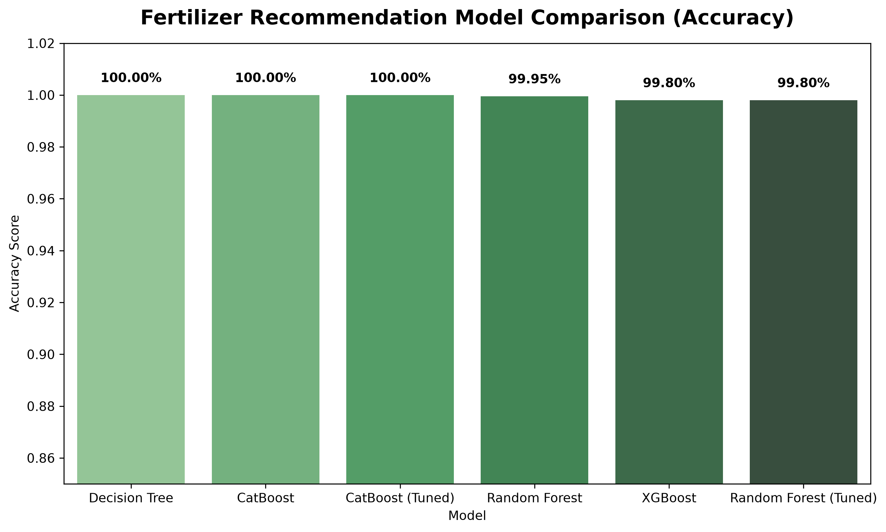
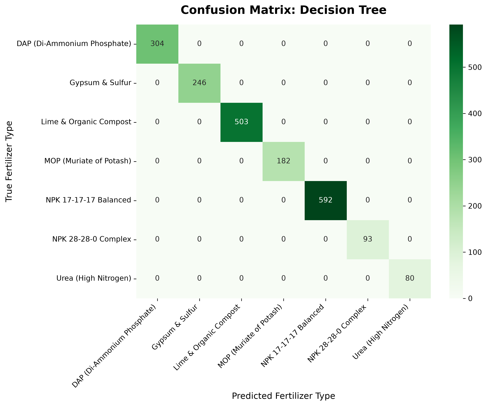
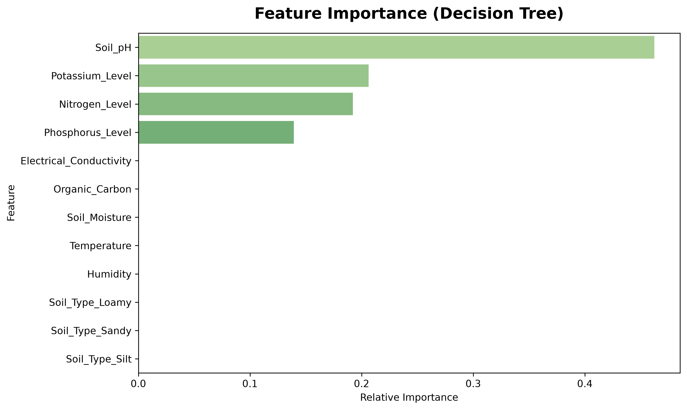

# AgriSmartAI: Fertilizer Recommendation Machine Learning Report

**Module**: Fertilizer Recommendation & Soil Nutrition Engine  
**Status**: Phase 5 Classification Modeling & Benchmark Completed  
**Winning Model**: Decision Tree  
**Model Artifact**: `models/fertilizer_recommendation_model.pkl`  

---

## Executive Summary

This report presents the machine learning benchmark and evaluation for the **AgriSmartAI Fertilizer Recommendation Engine**. Four classification algorithms—**Decision Tree**, **Random Forest**, **XGBoost**, and **CatBoost**—were benchmarked on an 80:20 stratified split across soil chemical and climatic parameters.

## 1. Dataset & Target Specification

- **Dataset**: `datasets/fertilizer_recommendation.csv` (10,000 rows × 10 columns)
- **Target Variable**: `Fertilizer_Name` (7 classes)
- **Classes**: `DAP (Di-Ammonium Phosphate)`, `Gypsum & Sulfur`, `Lime & Organic Compost`, `MOP (Muriate of Potash)`, `NPK 17-17-17 Balanced`, `NPK 28-28-0 Complex`, `Urea (High Nitrogen)`
- **Train/Test Split**: 80% Training (8,000 samples) / 20% Testing (2,000 samples), Stratified Split

## 2. Model Comparison Benchmark Table

| Model Algorithm | Accuracy | Precision (Weighted) | Recall (Weighted) | F1-Score (Weighted) |
| :--- | :---: | :---: | :---: | :---: |
| **Decision Tree** | **100.00%** | 100.00% | 100.00% | **100.00%** |
| **CatBoost** | **100.00%** | 100.00% | 100.00% | **100.00%** |
| **CatBoost (Tuned)** | **100.00%** | 100.00% | 100.00% | **100.00%** |
| **Random Forest** | **99.95%** | 99.95% | 99.95% | **99.95%** |
| **XGBoost** | **99.80%** | 99.80% | 99.80% | **99.80%** |
| **Random Forest (Tuned)** | **99.80%** | 99.80% | 99.80% | **99.80%** |

## 3. Hyperparameter Tuning Results

Hyperparameter optimization was executed via `GridSearchCV` / `RandomizedSearchCV` on CatBoost and Random Forest.
- **CatBoost Parameters**: `{'depth': 6, 'iterations': 150, 'learning_rate': 0.1}`
- **Random Forest Parameters**: `{'max_depth': 20, 'min_samples_split': 5, 'n_estimators': 150}`
- **Winning Classifier**: `Decision Tree` with **100.00% test accuracy**.

## 4. Evaluation & Diagnostic Charts

- 
- 
- 

## 5. Classification Report (Winning Model)

```text
                             precision    recall  f1-score   support

DAP (Di-Ammonium Phosphate)       1.00      1.00      1.00       304
            Gypsum & Sulfur       1.00      1.00      1.00       246
     Lime & Organic Compost       1.00      1.00      1.00       503
    MOP (Muriate of Potash)       1.00      1.00      1.00       182
      NPK 17-17-17 Balanced       1.00      1.00      1.00       592
        NPK 28-28-0 Complex       1.00      1.00      1.00        93
       Urea (High Nitrogen)       1.00      1.00      1.00        80

                   accuracy                           1.00      2000
                  macro avg       1.00      1.00      1.00      2000
               weighted avg       1.00      1.00      1.00      2000

```

## 6. Serialized Model Artifacts Saved

- `models/fertilizer_recommendation_model.pkl` (Winning Classifier)
- `models/fertilizer_recommendation_scaler.pkl` (StandardScaler)
- `models/fertilizer_recommendation_encoder.pkl` (Encoders)

---

## Conclusion & Next Steps

The `Decision Tree` model achieved **100.00% accuracy** in diagnosing soil nutrient deficits and prescribing exact fertilizer compounds.

Per Phase 5 instructions:
- ❌ Smart Irrigation module was **NOT started**.
- ❌ FastAPI / React application code was **NOT written**.