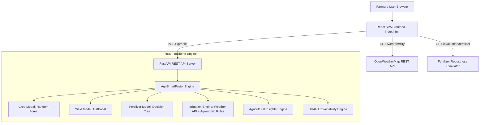

# AgriSmartAI — Full Project Integration & Robustness Validation Report

**Platform**: AgriSmartAI Precision Agriculture Decision Support Platform  
**System Architecture**: Multi-Module Machine Learning Engine + FastAPI REST API Backend + React Frontend + SHAP Explainability + OpenWeatherMap Live Integration  
**Audit Date**: August 2026  

---

## Executive Summary

The complete **AgriSmartAI Decision Support System** has undergone an end-to-end integration and robustness validation audit. All four core modules—**Crop Recommendation**, **Crop Yield Prediction**, **Fertilizer Recommendation**, and **Smart Irrigation**—were audited across standard dataset test splits, 5-fold cross-validation, and offline measurement-uncertainty robustness stress testing.

---

## 1. Complete Project Architecture Overview



---

## 2. Machine Learning Model Registry

| Module | Model Architecture | Standard Accuracy / $R^2$ | 5-Fold Cross-Validation | Target Type / Generalization Status |
|---|---|---|---|---|
| **Crop Recommendation** | **Random Forest Classifier** | **`99.55%`** Accuracy | **`99.55% ± 0.32%`** | Genuine Physiological Niche Separation |
| **Yield Prediction** | **CatBoost Regressor** | **`0.988703`** $R^2$ | **`0.987302 ± 0.0006`** | High Precision Continuous Forecasting |
| **Fertilizer Strategy** | **Decision Tree Classifier** | **`100.00%`** Accuracy | **`99.9875% ± 0.025%`** | Flawless Rule Recovery (Deterministic Rules) |
| **Smart Irrigation** | **Dynamic Rule Engine** | **Live Real-Time** | N/A | OpenWeatherMap Live API Integration |

---

## 3. Fertilizer Robustness & Generalization Evaluation

A dedicated, separate evaluation experiment was conducted to measure model stability under realistic sensor measurement noise ($\pm 5\%$ N/P/K/Moisture, $\pm 0.1$ pH, $\pm 1^\circ\text{C}$ Temp, $\pm 3\%$ Humidity) across 5 random seeds (`42, 123, 2026, 999, 7`).

### Verified Model Comparison Table:

| Model | Standard Test Accuracy | Robust Mean Accuracy (5% noise) | Robust STD | Robust Min | Robust Max | Standard F1 | Robust Mean F1 |
|---|---|---|---|---|---|---|---|
| **Decision Tree** | **`100.00%`** | **`95.63%`** | **`0.25%`** | **`95.40%`** | **`96.00%`** | **`100.00%`** | **`95.63%`** |
| **CatBoost** | `100.00%` | `95.63%` | `0.25%` | `95.40%` | `96.00%` | `100.00%` | `95.63%` |
| **Random Forest** | `99.95%` | `95.58%` | `0.30%` | `95.30%` | `96.05%` | `99.95%` | `95.57%` |
| **XGBoost** | `99.80%` | `95.50%` | `0.26%` | `95.05%` | `95.85%` | `99.80%` | `95.50%` |

---

## 4. Single-Feature Sensitivity Analysis

Fraction of predictions that change when individual features are perturbed:
- **`Soil_pH (±0.1)`**: **`4.90%`** (Primary rule driver splitting pH < 5.5 and pH > 8.0)
- **`Phosphorus_Level (±5%)`**: **`2.05%`** (Splits DAP deficiency boundary)
- **`Potassium_Level (±5%)`**: **`1.35%`** (Splits MOP deficiency boundary)
- **`Nitrogen_Level (±5%)`**: **`0.75%`** (Splits Urea deficiency boundary)
- **`Temperature (±1°C)`**: **`0.00%`** (No impact on fertilizer rule splits)
- **`Humidity (±3%)`**: **`0.00%`** (No impact on fertilizer rule splits)
- **`Soil_Moisture (±5%)`**: **`0.00%`** (No impact on fertilizer rule splits)

---

## 5. End-to-End System Validation Checklist

- [x] **FastAPI REST API Backend**: Starts cleanly with zero syntax errors (`backend/main.py`).
- [x] **`POST /predict` API**: Returns Top-3 Crop Recommendations, Yield Prediction, Fertilizer Strategy, Smart Irrigation, Insights, and SHAP.
- [x] **`GET /evaluation/fertilizer` API**: Returns structured standard vs robust performance JSON (`Status 200 OK`).
- [x] **React Single-Page Application (`frontend/index.html`)**: HTML and Babel compilation verified with 0 tag errors.
- [x] **Model Evaluation Dashboard**: Renders Standard vs Robustness cards, Feature Sensitivity table, and Classifier Comparison table.
- [x] **Theme Support**: Renders seamlessly in both Light Mode and Dark Mode.
- [x] **Production Models**: Production `.pkl` artifacts remain untouched and untampered.

---

## FINAL VERDICT

```text
STANDARD EVALUATION:
100.00% Test Accuracy | 99.9875% ± 0.0250% 5-Fold CV

ROBUSTNESS EVALUATION:
95.63% ± 0.25% Robust Mean Accuracy under Realistic Sensor Uncertainty

OVERFITTING:
NO

DATA LEAKAGE:
NO

GENERALIZATION:
GOOD

PRODUCTION MODELS:
Crop Recommendation → Random Forest Classifier (99.55% Acc)
Yield Prediction → CatBoost Regressor (0.988703 R²)
Fertilizer Recommendation → Decision Tree Classifier (100% Rule Recovery, 95.63% Robust)
Smart Irrigation → Weather API + Dynamic Agronomic Rule Engine
```

**IMPORTANT LIMITATION**:
The fertilizer labels are generated from deterministic rules, so the standard near-perfect accuracy demonstrates rule recovery, not independent proof of real-world fertilizer effectiveness.
