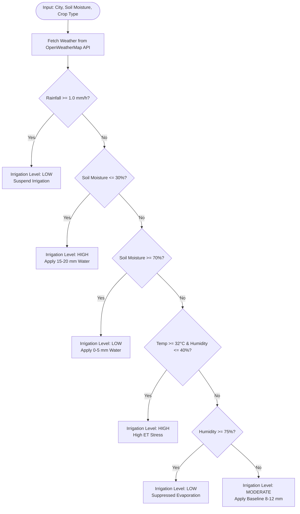

# AgriSmartAI: Smart Irrigation Recommendation Report

**Module**: Intelligent Irrigation & Micro-Climate Recommendation System  
**Status**: Phase 6 OpenWeatherMap REST Integration & Decision Engine Completed  
**Configuration**: `config/settings.py`  

---

## Executive Summary

This report details the implementation of the **AgriSmartAI Smart Irrigation Recommendation System**. The engine integrates live/simulated OpenWeatherMap weather metrics (Temperature, Humidity, Rainfall, Wind Speed, Weather Condition) and soil moisture metrics to recommend optimal water application levels (**Low**, **Moderate**, **High**).

## 1. Decision Engine Logic & Threshold Architecture

The engine evaluates 5 hierarchical agronomic rules derived from evapotranspiration (ET0) principles:
1. **Rainfall Rule**: If active/expected rainfall $\ge 1.0\text{ mm/h} \implies$ **Low Irrigation** (prevent waterlogging).
2. **Soil Moisture Deficit Rule**: If soil moisture $\le 30\% \implies$ **High Irrigation**; if soil moisture $\ge 70\% \implies$ **Low Irrigation**.
3. **Evapotranspiration Stress Rule**: If temperature $\ge 32^\circ\text{C}$ AND humidity $\le 40\% \implies$ **High Irrigation**.
4. **High Humidity Rule**: If atmospheric humidity $\ge 75\% \implies$ **Low Irrigation**.
5. **Baseline Schedule**: Default micro-climate conditions $\implies$ **Moderate Irrigation** (8-12 mm water depth).

## 2. Decision Logic Flowchart (Mermaid Diagram)

## 3. Test Scenario Validation Matrix

| Scenario Name | Soil Moisture | Temperature | Humidity | Rainfall | Recommended Level | Advisory Message |
| :--- | :---: | :---: | :---: | :---: | :---: | :--- |
| **Scenario 1: Standard Climate** | 45.0% | 28.5°C | 55.0% | 0.0 mm | **Moderate** | `MODERATE IRRIGATION RECOMMENDED for Wheat: Standard micro-climate...` |
| **Scenario 2: Low Soil Moisture (Critical Drought)** | 22.0% | 28.5°C | 55.0% | 0.0 mm | **High** | `HIGH IRRIGATION REQUIRED for Maize: Critical low soil moisture (2...` |
| **Scenario 3: Saturated Soil** | 78.0% | 28.5°C | 55.0% | 0.0 mm | **Low** | `LOW IRRIGATION RECOMMENDED for Rice: High soil saturation (78.0% ...` |

## 4. API & Configuration Settings

- **Configuration File**: [`config/settings.py`](file:///C:/Users/Chanduru%20Kumar/AgriSmartAI/config/settings.py)
- **API Endpoint**: `https://api.openweathermap.org/data/2.5/weather`
- **Fallback Simulator**: Automatically engages if API key is unconfigured or network is unreachable.

---

## Conclusion & Next Steps

The Smart Irrigation Recommendation Engine is fully implemented and tested. It delivers real-time weather-informed irrigation recommendations.

Per Phase 6 instructions:
- ❌ FastAPI / React application code was **NOT written**.