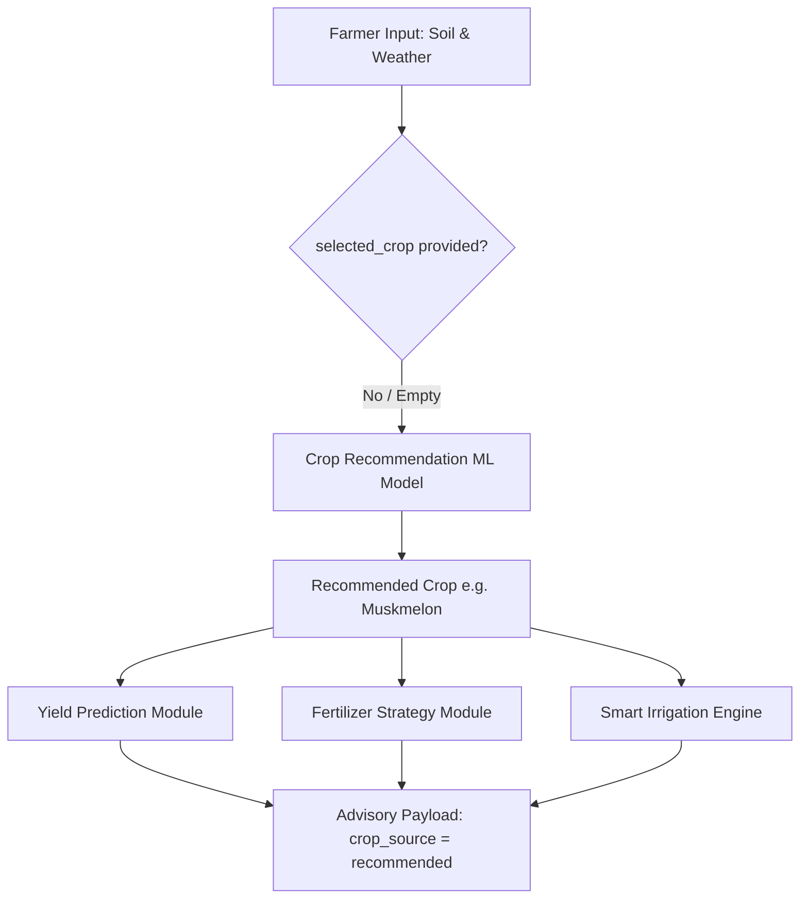
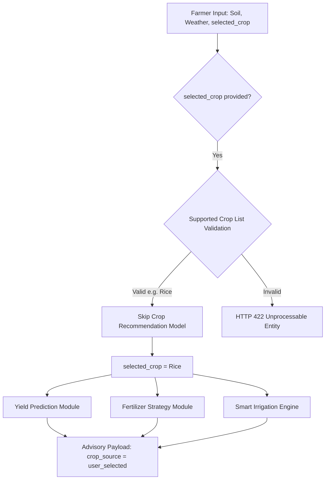

# AgriSmartAI: Optional Crop Selection Workflow Report

**Module**: Decision Support Pipeline Enhancement & Crop Selection Workflow  
**Status**: Enhancement Complete & Integration Tested  
**Report File**: `reports/optional_crop_workflow_report.md`  

---

## Executive Summary

This report documents the architectural enhancement implemented in **AgriSmartAI** for optional crop selection. The prediction engine seamlessly handles dual modes: **Mode 1 (Automatic Crop Recommendation)** when crop selection is omitted, and **Mode 2 (User Selected Crop)** when a specific supported crop is provided.

## 1. Workflow Architecture Diagrams

### Mode 1: Automatic Crop Recommendation


### Mode 2: User Selected Crop


## 2. API Request & Response Examples

### A. Mode 1 Output Payload (Automatic Mode)
```json
{
  "crop_source": "recommended",
  "recommended_crop": "Muskmelon",
  "selected_crop": null,
  "predicted_yield_tons_per_ha": 8.75,
  "fertilizer_recommendation": "4",
  "irrigation_recommendation": {
    "level": "Moderate",
    "water_depth_mm": "8-12",
    "message": "MODERATE IRRIGATION RECOMMENDED for Muskmelon: Standard micro-climate conditions (Temp: 28.5\u00b0C, Humidity: 55.0%, Moisture: 45.0%). Apply baseline 8-12 mm of water."
  },
  "weather_summary": {
    "city": "Bengaluru",
    "temperature": 28.5,
    "humidity": 55.0,
    "rainfall": 0.0,
    "condition": "Partly Cloudy (Simulated Fallback)",
    "wind_speed": 3.2,
    "source": "Simulated Weather Engine"
  },
  "confidence_scores": {
    "crop_recommendation_confidence_pct": 36.0,
    "fertilizer_recommendation_confidence_pct": 100.0,
    "yield_model_r2_metric": 0.9842
  },
  "explainability": {
    "crop_recommendation": {
      "top_5_features": [
        {
          "feature": "P",
          "shap_value": 0.21797869340241505,
          "abs_shap_value": 0.21797869340241505
        },
        {
          "feature": "K",
          "shap_value": 0.15594528491002113,
          "abs_shap_value": 0.15594528491002113
        },
        {
          "feature": "humidity",
          "shap_value": 0.09439693980147298,
          "abs_shap_value": 0.09439693980147298
        },
        {
          "feature": "rainfall",
          "shap_value": 0.0841055125345819,
          "abs_shap_value": 0.0841055125345819
        },
        {
          "feature": "N",
          "shap_value": -0.05843285434608878,
          "abs_shap_value": 0.05843285434608878
        }
      ],
      "plain_language_explanation": "The crop recommendation was influenced primarily by:\n1. P (+0.22)\n2. K (+0.16)\n3. humidity (+0.09)\n4. rainfall (+0.08)\n5. N (-0.06)"
    },
    "yield_prediction": {
      "top_5_features": [
        {
          "feature": "Nitrogen_Level",
          "shap_value": 1.3394827842712402,
          "abs_shap_value": 1.3394827842712402
        },
        {
          "feature": "Soil_Moisture",
          "shap_value": 0.5343748331069946,
          "abs_shap_value": 0.5343748331069946
        },
        {
          "feature": "Potassium_Level",
          "shap_value": 0.5225319266319275,
          "abs_shap_value": 0.5225319266319275
        },
        {
          "feature": "Phosphorus_Level",
          "shap_value": 0.4491674602031708,
          "abs_shap_value": 0.4491674602031708
        },
        {
          "feature": "Organic_Carbon",
          "shap_value": 0.34093186259269714,
          "abs_shap_value": 0.34093186259269714
        }
      ],
      "plain_language_explanation": "The yield prediction was influenced primarily by:\n1. Nitrogen_Level (+1.34)\n2. Soil_Moisture (+0.53)\n3. Potassium_Level (+0.52)\n4. Phosphorus_Level (+0.45)\n5. Organic_Carbon (+0.34)"
    },
    "fertilizer_recommendation": {
      "top_5_features": [
        {
          "feature": "Soil_pH",
          "shap_value": -0.08997753532088125,
          "abs_shap_value": 0.08997753532088125
        },
        {
          "feature": "Phosphorus_Level",
          "shap_value": -0.08997753532088125,
          "abs_shap_value": 0.08997753532088125
        },
        {
          "feature": "Potassium_Level",
          "shap_value": 0.02007843929597701,
          "abs_shap_value": 0.02007843929597701
        },
        {
          "feature": "Nitrogen_Level",
          "shap_value": 0.008126631345785446,
          "abs_shap_value": 0.008126631345785446
        },
        {
          "feature": "Soil_Moisture",
          "shap_value": 0.0,
          "abs_shap_value": 0.0
        }
      ],
      "plain_language_explanation": "The fertilizer recommendation was influenced primarily by:\n1. Soil_pH (-0.09)\n2. Phosphorus_Level (-0.09)\n3. Potassium_Level (+0.02)\n4. Nitrogen_Level (+0.01)\n5. Soil_Moisture (+0.00)"
    }
  }
}
```

### B. Mode 2 Output Payload (User Selected Mode)
```json
{
  "crop_source": "user_selected",
  "recommended_crop": null,
  "selected_crop": "Rice",
  "predicted_yield_tons_per_ha": 8.75,
  "fertilizer_recommendation": "4",
  "irrigation_recommendation": {
    "level": "Moderate",
    "water_depth_mm": "8-12",
    "message": "MODERATE IRRIGATION RECOMMENDED for Rice: Standard micro-climate conditions (Temp: 28.5\u00b0C, Humidity: 55.0%, Moisture: 45.0%). Apply baseline 8-12 mm of water."
  },
  "weather_summary": {
    "city": "Bengaluru",
    "temperature": 28.5,
    "humidity": 55.0,
    "rainfall": 0.0,
    "condition": "Partly Cloudy (Simulated Fallback)",
    "wind_speed": 3.2,
    "source": "Simulated Weather Engine"
  },
  "confidence_scores": {
    "crop_recommendation_confidence_pct": 100.0,
    "fertilizer_recommendation_confidence_pct": 100.0,
    "yield_model_r2_metric": 0.9842
  },
  "explainability": {
    "crop_recommendation": {
      "top_5_features": [
        {
          "feature": "P",
          "shap_value": 0.21797869340241505,
          "abs_shap_value": 0.21797869340241505
        },
        {
          "feature": "K",
          "shap_value": 0.15594528491002113,
          "abs_shap_value": 0.15594528491002113
        },
        {
          "feature": "humidity",
          "shap_value": 0.09439693980147298,
          "abs_shap_value": 0.09439693980147298
        },
        {
          "feature": "rainfall",
          "shap_value": 0.0841055125345819,
          "abs_shap_value": 0.0841055125345819
        },
        {
          "feature": "N",
          "shap_value": -0.05843285434608878,
          "abs_shap_value": 0.05843285434608878
        }
      ],
      "plain_language_explanation": "The crop suitability was influenced primarily by:\n1. P (+0.22)\n2. K (+0.16)\n3. humidity (+0.09)\n4. rainfall (+0.08)\n5. N (-0.06)"
    },
    "yield_prediction": {
      "top_5_features": [
        {
          "feature": "Nitrogen_Level",
          "shap_value": 1.3394827842712402,
          "abs_shap_value": 1.3394827842712402
        },
        {
          "feature": "Soil_Moisture",
          "shap_value": 0.5343748331069946,
          "abs_shap_value": 0.5343748331069946
        },
        {
          "feature": "Potassium_Level",
          "shap_value": 0.5225319266319275,
          "abs_shap_value": 0.5225319266319275
        },
        {
          "feature": "Phosphorus_Level",
          "shap_value": 0.4491674602031708,
          "abs_shap_value": 0.4491674602031708
        },
        {
          "feature": "Organic_Carbon",
          "shap_value": 0.34093186259269714,
          "abs_shap_value": 0.34093186259269714
        }
      ],
      "plain_language_explanation": "The yield prediction was influenced primarily by:\n1. Nitrogen_Level (+1.34)\n2. Soil_Moisture (+0.53)\n3. Potassium_Level (+0.52)\n4. Phosphorus_Level (+0.45)\n5. Organic_Carbon (+0.34)"
    },
    "fertilizer_recommendation": {
      "top_5_features": [
        {
          "feature": "Soil_pH",
          "shap_value": -0.08997753532088125,
          "abs_shap_value": 0.08997753532088125
        },
        {
          "feature": "Phosphorus_Level",
          "shap_value": -0.08997753532088125,
          "abs_shap_value": 0.08997753532088125
        },
        {
          "feature": "Potassium_Level",
          "shap_value": 0.02007843929597701,
          "abs_shap_value": 0.02007843929597701
        },
        {
          "feature": "Nitrogen_Level",
          "shap_value": 0.008126631345785446,
          "abs_shap_value": 0.008126631345785446
        },
        {
          "feature": "Soil_Moisture",
          "shap_value": 0.0,
          "abs_shap_value": 0.0
        }
      ],
      "plain_language_explanation": "The fertilizer recommendation was influenced primarily by:\n1. Soil_pH (-0.09)\n2. Phosphorus_Level (-0.09)\n3. Potassium_Level (+0.02)\n4. Nitrogen_Level (+0.01)\n5. Soil_Moisture (+0.00)"
    }
  }
}
```

### C. Validation Error Response (Invalid Crop)
```json
{
  "status": "error",
  "error_type": "Validation Error",
  "message": "Invalid input parameters provided.",
  "details": [
    "Field 'body -> selected_crop': Value error, Invalid crop 'NonExistentCrop'. Supported crops are: rice, maize, chickpea, kidneybeans, pigeonpeas, mothbeans, mungbean, blackgram, lentil, pomegranate, banana, mango, grapes, watermelon, muskmelon, apple, orange, papaya, coconut, cotton, jute, coffee, wheat"
  ]
}
```

## 3. Supported Crops Validation List

The 23 validated crops supported by the pipeline are:
`rice, maize, chickpea, kidneybeans, pigeonpeas, mothbeans, mungbean, blackgram, lentil, pomegranate, banana, mango, grapes, watermelon, muskmelon, apple, orange, papaya, coconut, cotton, jute, coffee, wheat`

## 4. Frontend UI Behavior & Badges

- **Input Helper Text**: *'Leave this field empty to receive the best crop recommendation automatically. If you choose a crop, the system will predict the yield and provide fertilizer and irrigation recommendations specifically for that crop.'*
- **Mode Badges**:
  - Automatic Mode: `[🤖 Automatic Crop Recommendation Mode]` (Green)
  - Manual Mode: `[👤 User Selected Crop Mode]` (Blue)

---

## Conclusion & Next Steps

The optional crop selection workflow is fully functional, validated, and integrated across backend and frontend components.