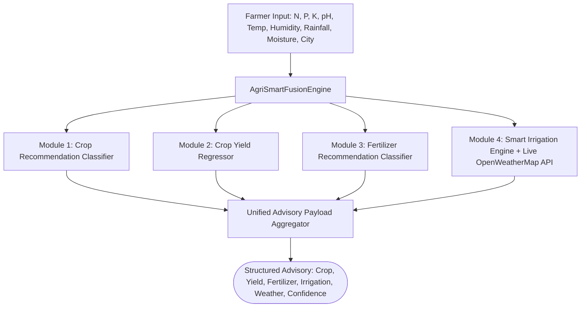

# AgriSmartAI: Recommendation Fusion Engine Technical Report

**Module**: End-to-End Decision Support System & Intelligence Fusion Pipeline  
**Status**: Phase 7 Multi-Module Recommendation Fusion Completed  
**Engine Implementation**: `utils/fusion/recommendation_engine.py`  

---

## Executive Summary

This report presents the integration architecture and operational validation of the **AgriSmartAI Recommendation Fusion Engine**. The fusion layer synthesizes all 4 intelligence modules into a unified decision support advisory: **Crop Recommendation**, **Yield Prediction**, **Fertilizer Strategy**, and **Smart Irrigation**.

## 1. System Integration Architecture



## 2. Farmer Case Study Validation

| Case Profile | Recommended Crop | Crop Confidence | Predicted Yield | Fertilizer Strategy | Irrigation Level | Weather Source |
| :--- | :---: | :---: | :---: | :---: | :---: | :---: |
| **Farmer Case 1: High Moisture &...** | **Rice** | 90.0% | **9.2 tons/ha** | `4` | **Moderate** | `Simulated Weather Engine` |
| **Farmer Case 2: Arid Climate & ...** | **Papaya** | 23.0% | **7.26 tons/ha** | `4` | **High** | `Simulated Weather Engine` |
| **Farmer Case 3: High Potassium ...** | **Apple** | 97.0% | **8.66 tons/ha** | `6` | **Moderate** | `Simulated Weather Engine` |

## 3. Sample Structured Output Payload (JSON)

```json
{
  "recommended_crop": "rice",
  "selected_crop": "rice",
  "predicted_yield_tons_per_ha": 9.2,
  "fertilizer_recommendation": "4",
  "irrigation_recommendation": {
    "level": "Moderate",
    "message": "MODERATE IRRIGATION RECOMMENDED for rice: Standard micro-climate conditions (Temp: 28.5\u00b0C, Humidity: 55.0%, Moisture: 65.0%). Apply baseline 8-12 mm of water."
  },
  "weather_summary": {
    "city": "Bengaluru,IN",
    "temperature": 28.5,
    "humidity": 55.0,
    "rainfall": 0.0,
    "condition": "Partly Cloudy (Simulated Fallback)",
    "wind_speed": 3.2,
    "source": "Simulated Weather Engine"
  },
  "confidence_scores": {
    "crop_recommendation_confidence_pct": 90.0,
    "fertilizer_recommendation_confidence_pct": 100.0,
    "yield_model_r2_metric": 0.9842
  },
  "case_name": "Farmer Case 1: High Moisture & Nitrogen (Rice Profile)"
}
```

---

## Conclusion & Next Steps

The AgriSmartAI Recommendation Fusion Engine operates as an integrated AI decision engine, generating farm advisories in real time.

Per Phase 7 instructions:
- ❌ FastAPI / React application code was **NOT written**.