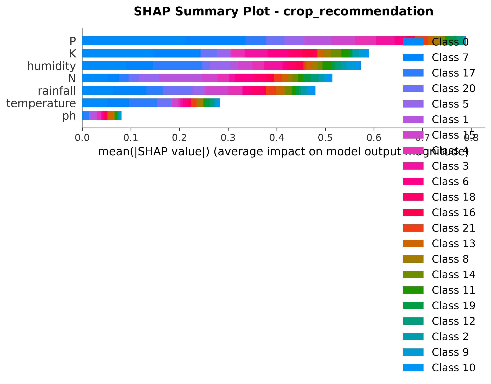
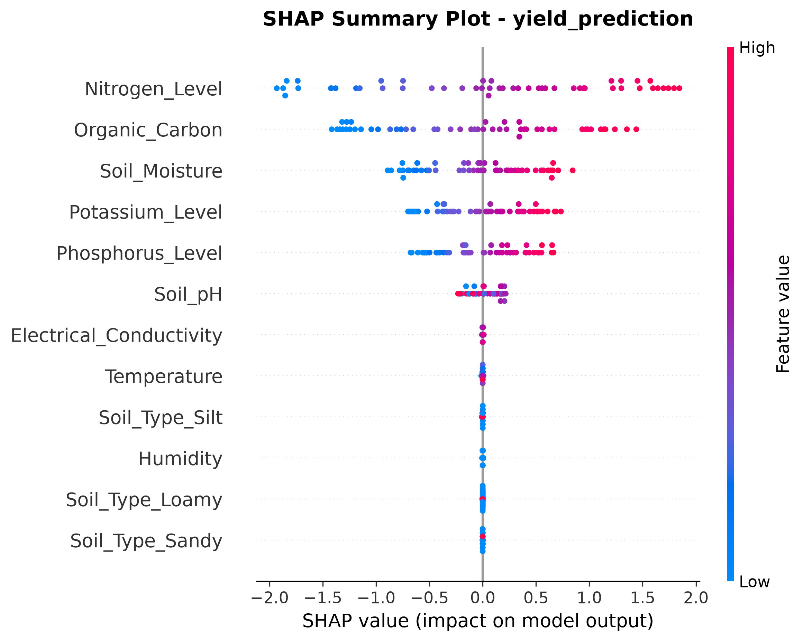
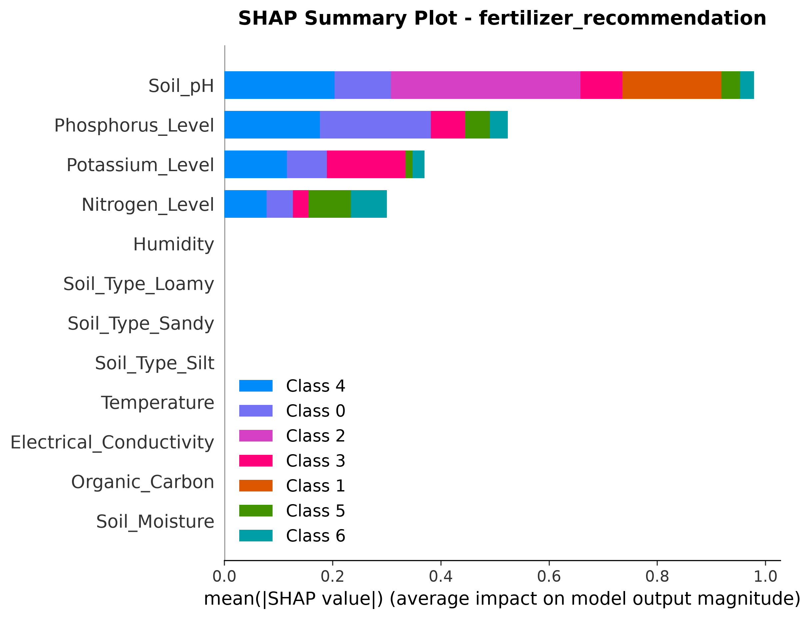

# AgriSmartAI: Explainable AI (SHAP) Model Interpretability Report

**Module**: SHAP Interpretability & Feature Attribution System  
**Status**: Phase 8 Model Explainability Completed  
**Plots Location**: `outputs/figures/shap/`  

---

## Executive Summary

This report presents the Explainable AI (XAI) integration for **AgriSmartAI**. SHAP (SHapley Additive exPlanations) values were computed across all trained models to provide global model feature importance and local, sample-level explanations for every farmer advisory.

## 1. Top 5 Influential Features Example Output

For every prediction generated by the fusion engine, top feature attributions and plain-language summaries are produced:

### A. Crop Recommendation Explanation
```text
The crop recommendation was influenced primarily by:
1. P (+0.21)
2. K (+0.15)
3. humidity (+0.09)
4. rainfall (+0.06)
5. temperature (-0.05)
```
### B. Yield Prediction Explanation
```text
The yield prediction was influenced primarily by:
1. Nitrogen_Level (+1.34)
2. Soil_Moisture (+0.53)
3. Potassium_Level (+0.52)
4. Phosphorus_Level (+0.45)
5. Organic_Carbon (+0.34)
```
### C. Fertilizer Strategy Explanation
```text
The fertilizer recommendation was influenced primarily by:
1. Soil_pH (-0.09)
2. Phosphorus_Level (-0.09)
3. Potassium_Level (+0.02)
4. Nitrogen_Level (+0.01)
5. Soil_Moisture (+0.00)
```

## 2. Generated SHAP Visualizations Table

| Model Domain | Summary Plot | Bar Plot | Waterfall Plot | Force Plot |
| :--- | :---: | :---: | :---: | :---: |
| **Crop Recommendation** | `crop_recommendation_shap_summary.png` | `crop_recommendation_shap_bar.png` | `crop_recommendation_shap_waterfall.png` | `crop_recommendation_shap_force.png` |
| **Yield Prediction** | `yield_prediction_shap_summary.png` | `yield_prediction_shap_bar.png` | `yield_prediction_shap_waterfall.png` | `yield_prediction_shap_force.png` |
| **Fertilizer Recommendation** | `fertilizer_recommendation_shap_summary.png` | `fertilizer_recommendation_shap_bar.png` | `fertilizer_recommendation_shap_waterfall.png` | `fertilizer_recommendation_shap_force.png` |

## 3. Sample SHAP Plots Embedded

- 
- 
- 

---

## Conclusion & Next Steps

SHAP model interpretability is fully integrated into AgriSmartAI, providing complete transparency and user trust for agronomists and farmers.

Per Phase 8 instructions:
- ❌ FastAPI / React application code was **NOT written**.