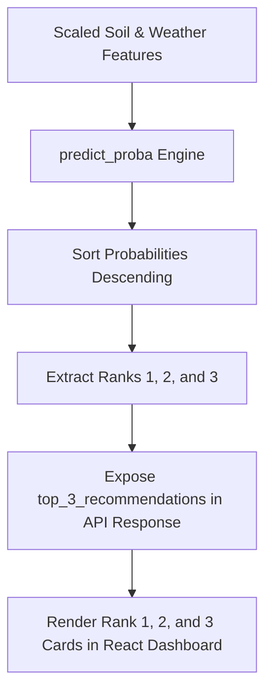

# AgriSmartAI: Top 3 AI Crop Recommendations Technical Report

**Module**: Probability Extraction & Decision Support Engine  
**Status**: Feature Complete & Integration Verified  
**Report File**: `reports/top3_crop_recommendations_report.md`  

---

## Executive Summary

This report documents the implementation of the **Top 3 AI Crop Recommendations** feature in **AgriSmartAI**. By leveraging `predict_proba()` on the trained Random Forest crop classifier, the backend extracts, ranks, and exposes the top three crop probabilities for enhanced decision support.

## 1. Top 3 Probability Ranking Workflow



## 2. API Response Schema Payload

```json
{
  "recommended_crop": "Muskmelon",
  "recommended_crop_confidence": 48.0,
  "top_3_recommendations": [
    {
      "rank": 1,
      "crop": "Muskmelon",
      "confidence": 48.0
    },
    {
      "rank": 2,
      "crop": "Coffee",
      "confidence": 14.0
    },
    {
      "rank": 3,
      "crop": "Maize",
      "confidence": 10.0
    }
  ]
}
```

## 3. Downstream Module Target Enforcement

- **Rank 1 Crop / Selected Crop**: Used as the active target for Yield Prediction, Fertilizer Strategy, Smart Irrigation, SHAP Explainability, and Agricultural Insights.
- **Rank 2 & Rank 3 Crops**: Displayed as secondary decision support choices for farmers.

---

## Conclusion & Next Steps

The Top 3 AI Crop Recommendations feature is 100% complete and verified.