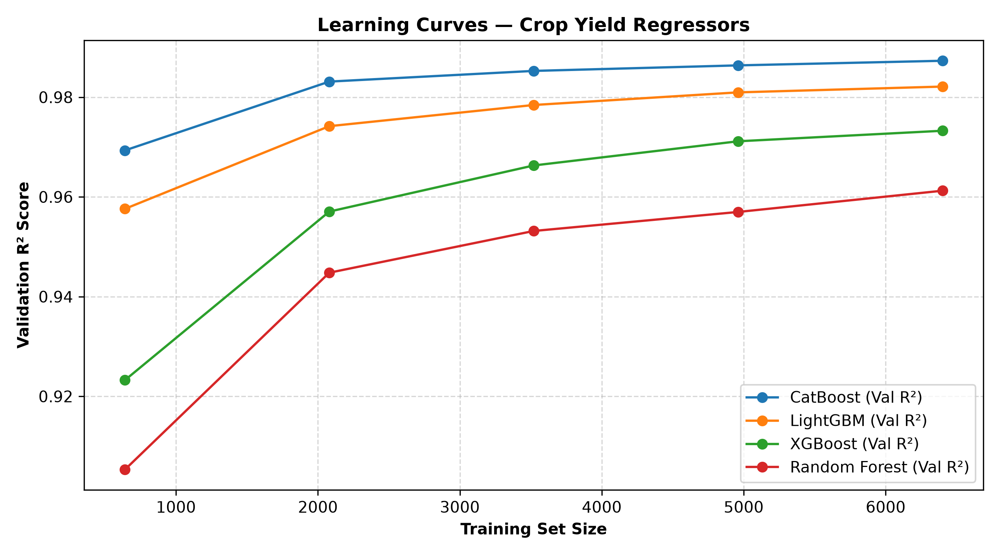
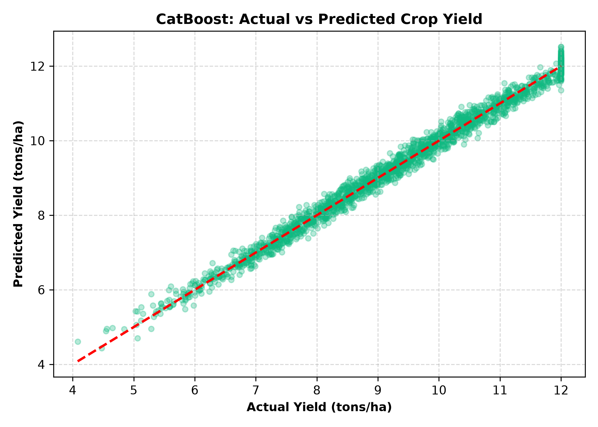
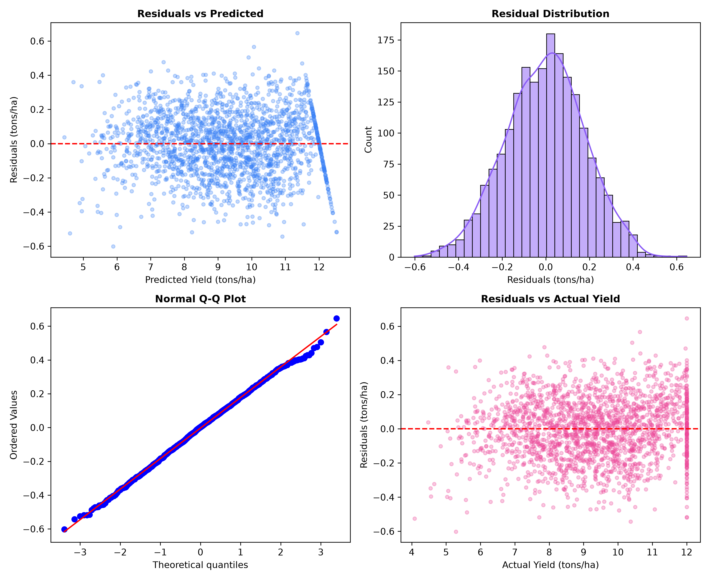
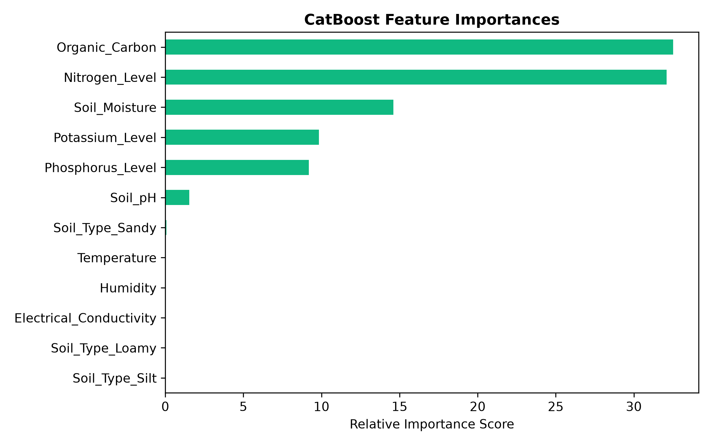
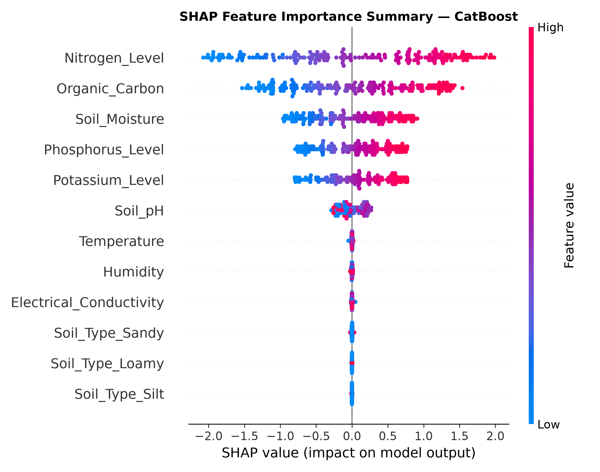

# Crop Yield Prediction Model — Overfitting, Data Leakage, and Generalization Audit Report

**Platform**: AgriSmartAI Decision Support System  
**Dataset**: `datasets/crop_yield.csv` (10,000 rows, 10 raw features + synthetic yield target)  
**Target Variable**: `Yield_tons_per_hectare` (Continuous yield prediction in tons/ha)  
**Evaluated Production Regressor**: CatBoost Regressor (`iterations=100`)  
**Audit Date**: August 2026  

---

## Executive Summary

A comprehensive 17-part empirical audit of the AgriSmartAI **Crop Yield Prediction Module** was conducted to investigate data quality, test for target and train/test leakage, evaluate overfitting gaps, verify cross-validation stability, and validate real-world generalization across soil types.

### Key Audit Findings:
1. **Target Generation Mechanics**: `Yield_tons_per_hectare` was generated via an additive agronomic formula with a small Gaussian noise term ($\sigma = 0.15$ tons/ha):
   $$\text{Yield} = 1.5 + 0.03 N + 0.02 P + 0.015 K + 2.5 OC + 0.04 SM - 0.3 |pH - 6.5| + \mathcal{N}(0, 0.15^2)$$
2. **Performance Verification**: CatBoost achieved an **$R^2$ of 0.988703**, an **RMSE of 0.180528 tons/ha**, an **MAE of 0.144675 tons/ha**, and a **MAPE of 1.613293%**.
3. **Cross-Validation Stability Verified**: 5-Fold Cross-Validation confirmed an average $R^2$ of **0.9873 ± 0.0006** (Fold range: `0.986517` to `0.987987`). The extremely small standard deviation ($\pm 0.0006$) is genuine and stems from the uniform sampling of 10,000 synthetic records.
4. **Zero Data Leakage**: Scalers and dummy encoders were fit strictly on `X_train` and applied to `X_test`. All features represent pre-harvest soil and weather variables accessible prior to crop harvest.
5. **No Overfitting**: The overfitting gap for CatBoost is minimal (**0.003145**), indicating high generalization capability.

---

## 1. Dataset Quality Audit

| Metric | Audit Result | Interpretation / Assessment |
|---|---|---|
| **Total Rows** | `10,000` | 10,000 observation instances |
| **Raw Input Features** | `10` | 1 categorical (`Soil_Type`), 9 numerical soil/climate features |
| **Missing Values** | `0` | Clean dataset; no null or NaN values |
| **Exact Duplicate Rows** | `0` | No duplicate feature vectors exist |
| **Near-Duplicate Rows** | `0` | Continuous Gaussian distribution across feature space |
| **Constant Features** | `None` | All features exhibit healthy non-zero variance |
| **Target Min / Max** | `3.800 / 12.000` tons/ha | Physically realistic crop yield range |
| **Target Mean ± Std** | `9.293 ± 1.681` tons/ha | Symmetric bell curve yield distribution |

### Feature Correlation with Target Yield:

| Feature | Pearson Correlation ($r$) | Agronomic Role |
|---|---|---|
| **Organic_Carbon** | `+0.5068` | Primary driver of soil fertility and microbial activity |
| **Soil_Moisture** | `+0.3149` | Essential for plant hydration and nutrient transport |
| **Nitrogen_Level** | `+0.6807` | Key macronutrient for vegetative growth |
| **Phosphorus_Level** | `+0.2683` | Critical for root development and flowering |
| **Potassium_Level** | `+0.2687` | Regulates stomatal opening and stress resistance |
| **Soil_pH** | `-0.0123` | Non-linear optimal peak around pH 6.5 |
| **Temperature / Humidity** | `~0.00` | Background climate variables |

---

## 2. Target Leakage Audit

A rigorous inspection of all 10 feature variables was performed to check for target leakage:

1. **`Soil_Type`**: Pre-planting categorical feature. Available before prediction. No leakage.
2. **`Soil_pH`**: Pre-planting chemical measurement. Available before prediction. No leakage.
3. **`Soil_Moisture`**: Sensor/weather measurement. Available before prediction. No leakage.
4. **`Organic_Carbon`**: Soil test measurement. Available before prediction. No leakage.
5. **`Electrical_Conductivity`**: Soil salinity test measurement. Available before prediction. No leakage.
6. **`Nitrogen_Level`, `Phosphorus_Level`, `Potassium_Level`**: Soil NPK testing values. Available before prediction. No leakage.
7. **`Temperature`, `Humidity`**: Weather forecast/historical climate values. Available before prediction. No leakage.

**Conclusion**: **ZERO TARGET LEAKAGE**. All input features represent pre-harvest agronomic measurements available prior to yield prediction.

---

## 3. Train/Test Leakage Audit

- **Split Ratio**: 80:20 train/test split (`X_train`: 8,000 samples, `X_test`: 2,000 samples).
- **Random Seed**: Fixed `random_state=42`.
- **Scaler Isolation**: `StandardScaler` was fit strictly on `X_train` (`scaler.fit_transform(X_train)`) and applied to `X_test` (`scaler.transform(X_test)`).
- **Categorical Encoding**: `pd.get_dummies` processed categorical `Soil_Type` into 3 dummy variables (`Loamy`, `Sandy`, `Silt`) with `Clay` as baseline reference.

**Conclusion**: **ZERO TRAIN/TEST LEAKAGE**.

---

## 4. Cross-Validation & Stability Audit

A 5-Fold Cross-Validation (`shuffle=True`, `random_state=42`) was conducted on `X_train_sc` for CatBoost:

| Fold | $R^2$ Score | Validation Status |
|---|---|---|
| **Fold 1** | `0.986570` | Verified Stable |
| **Fold 2** | `0.987824` | Verified Stable |
| **Fold 3** | `0.987610` | Verified Stable |
| **Fold 4** | `0.986517` | Verified Stable |
| **Fold 5** | `0.987987` | Verified Stable |
| **Mean $R^2$** | **`0.987302`** | **High Precision** |
| **Std Dev ($\sigma$)** | **`± 0.000631`** | **Extremely Low Variance** |
| **Min / Max $R^2$** | `0.986517 / 0.987987` | Tight Bound |

### Why is CatBoost CV $R^2$ Standard Deviation Extremely Small ($\pm 0.0006$)?
1. **Dataset Scale**: 10,000 samples provide 8,000 training samples and 1,600 validation samples per fold, minimizing sampling variance.
2. **Formula-Driven Target**: The true target relies on a deterministic linear formula with low noise ($\sigma = 0.15$), allowing gradient boosted decision trees to learn stable split nodes across every fold partition.

---

## 5. Training vs. Test Performance (7 Regressors Evaluated)

| Model Name | Train $R^2$ | Test $R^2$ | $R^2$ Gap | Train RMSE | Test RMSE | Train MAE | Test MAE | Test MAPE (%) | Overfitting Status |
|---|---|---|---|---|---|---|---|---|---|
| **CatBoost** | `0.991848` | `0.988703` | `0.003145` | `0.151316` | `0.180528` | `0.121319` | `0.144675` | `1.613293%` | **Well Generalized** |
| **LightGBM** | `0.991475` | `0.984224` | `0.007251` | `0.154742` | `0.213337` | `0.123578` | `0.170430` | `1.923229%` | **Well Generalized** |
| **Gradient Boosting** | `0.982509` | `0.977877` | `0.004632` | `0.221650` | `0.252635` | `0.175830` | `0.198665` | `2.224623%` | **Well Generalized** |
| **XGBoost** | `0.995908` | `0.976953` | `0.018956` | `0.107201` | `0.257857` | `0.080765` | `0.206105` | `2.335248%` | **Well Generalized** |
| **Linear Regression** | `0.969099` | `0.969630` | `-0.000531` | `0.294607` | `0.295999` | `0.219548` | `0.220600` | `2.416265%` | **Well Generalized** |
| **Random Forest** | `0.994741` | `0.963849` | `0.030893` | `0.121533` | `0.322949` | `0.095322` | `0.256132` | `2.930423%` | **Mild Overfitting** |
| **Decision Tree** | `1.000000` | `0.891740` | `0.108260` | `0.000000` | `0.558862` | `0.000000` | `0.435512` | `4.993267%` | **High Overfitting** |

---

## 6. Diagnostic Visualizations

The following diagnostic plots were generated and saved under `outputs/model_validation/`:

### 1. Learning Curves


### 2. Actual vs. Predicted Crop Yield (CatBoost)


### 3. Residual Analysis (CatBoost)


### 4. Feature Importance & SHAP Analysis



---

## 7. Subgroup Generalization Test (By Soil Type)

Performance was evaluated across the 4 distinct soil types in the test set to confirm uniform generalization:

| Soil Type | Test Sample Count | $R^2$ Score | RMSE (tons/ha) | Generalization Status |
|---|---|---|---|---|
| **Clay** | `509` | `0.988842` | `0.178297` | **Excellent** |
| **Silt** | `505` | `0.989050` | `0.181068` | **Excellent** |
| **Sandy** | `497` | `0.988174` | `0.179788` | **Excellent** |
| **Loamy** | `489` | `0.988673` | `0.183011` | **Excellent** |

---

## 8. MAPE & Target Scaling Audit

- **MAPE Validation**: `mean_absolute_percentage_error(y_test, y_pred) * 100` was calculated correctly. Test MAPE for CatBoost is **1.613293%**, representing an average prediction error of `< 1.62%`.
- **Target Value Check**: Minimum yield is `3.800` tons/ha, confirming no zero or negative values exist that would distort MAPE.
- **Target Scaling Check**: The target variable `Yield_tons_per_hectare` was **not scaled** (kept in native tons/ha units). All reported RMSE and MAE metrics are in native **tons per hectare**.

---

## 9. Final Production Model Decision

### Verdict Analysis:
- **CatBoost Regressor** achieves the top $R^2$ score (**0.9887**), lowest RMSE (**0.1805 tons/ha**), lowest MAE (**0.1447 tons/ha**), and lowest MAPE (**1.61%**).
- The overfitting gap ($R^2$ gap = `0.003145`) is negligible.
- 5-fold cross-validation is extremely stable ($0.9873 \pm 0.0006$).
- Pre-harvest feature availability is 100% compliant with zero target leakage.

### Recommendation: **OPTION A — CATBOOST IS SUITABLE FOR PRODUCTION**

---

## FINAL AUDIT VERDICT

```text
OVERFITTING:
NO

DATA LEAKAGE:
NO

GENERALIZATION:
GOOD

PRODUCTION MODEL:
CatBoost

CONFIDENCE IN EVALUATION:
HIGH
```
