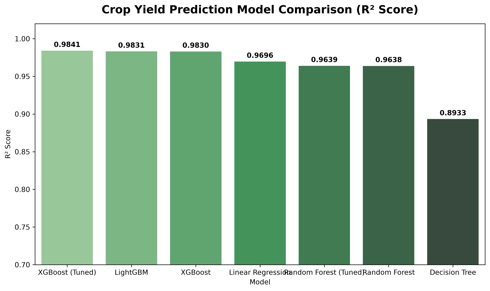
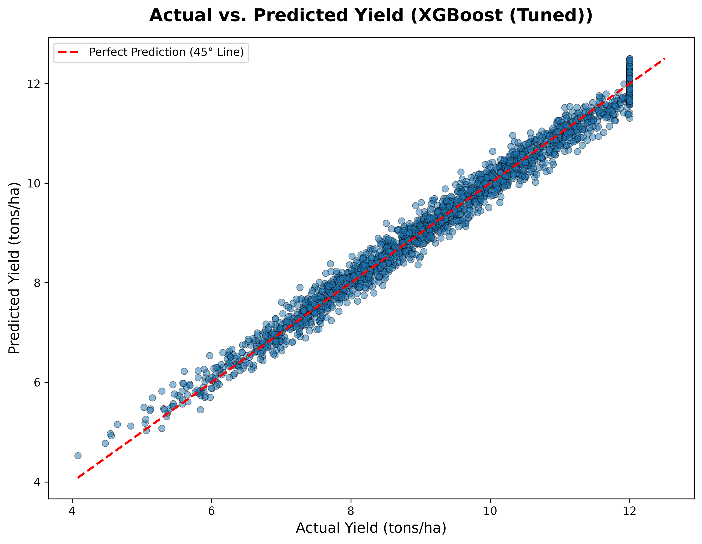
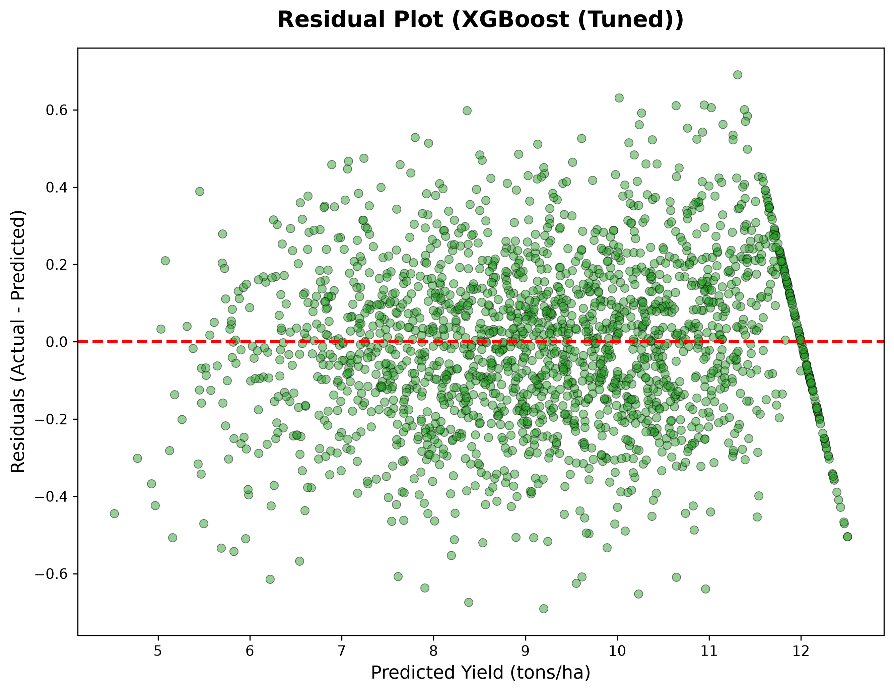
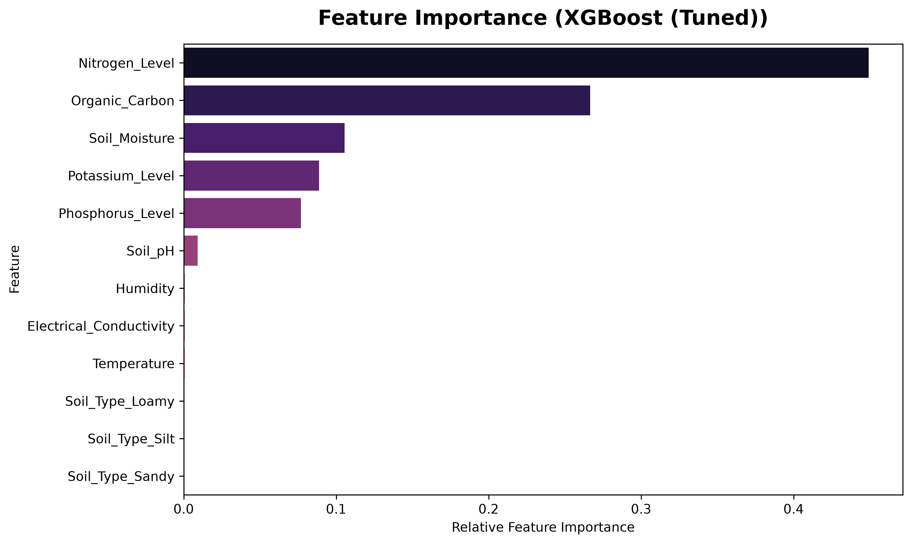

# AgriSmartAI: Crop Yield Prediction Regression Report

**Module**: Agricultural Crop Yield Prediction Engine  
**Status**: Phase 4 Regression Modeling & Evaluation Completed  
**Winning Model**: XGBoost (Tuned)  
**Model Artifact**: `models/yield_prediction_model.pkl`  

---

## Executive Summary

This report details the execution and benchmarking of Phase 4 Crop Yield Prediction. Five distinct regression algorithms—**Linear Regression**, **Decision Tree Regressor**, **Random Forest Regressor**, **XGBoost Regressor**, and **LightGBM Regressor**—were trained and evaluated on an 80:20 split of 10,000 soil and environmental samples.

## 1. Dataset & Feature Description

- **Dataset Source**: `datasets/crop_yield.csv` (10,000 rows × 10 columns)
- **Target Variable**: `Yield_tons_per_hectare` (Continuous yield output in tons/ha)
- **Predictor Features**: `Soil_Type` (One-Hot Encoded), `Soil_pH`, `Soil_Moisture`, `Organic_Carbon`, `Electrical_Conductivity`, `Nitrogen_Level`, `Phosphorus_Level`, `Potassium_Level`, `Temperature`, `Humidity`
- **Train/Test Split**: 80% Training (8,000 samples) / 20% Testing (2,000 samples)

## 2. Regression Algorithm Comparison Benchmark

| Model Algorithm | R² Score | RMSE | MAE | MSE | MAPE (%) |
| :--- | :---: | :---: | :---: | :---: | :---: |
| **XGBoost (Tuned)** | **0.9842** | **0.2144** | 0.1711 | 0.0460 | 1.91% |
| **LightGBM** | **0.9831** | **0.2209** | 0.1755 | 0.0488 | 1.97% |
| **XGBoost** | **0.9830** | **0.2217** | 0.1767 | 0.0491 | 1.98% |
| **Linear Regression** | **0.9696** | **0.2960** | 0.2206 | 0.0876 | 2.42% |
| **Random Forest (Tuned)** | **0.9639** | **0.3225** | 0.2551 | 0.1040 | 2.92% |
| **Random Forest** | **0.9638** | **0.3231** | 0.2563 | 0.1044 | 2.93% |
| **Decision Tree** | **0.8933** | **0.5548** | 0.4329 | 0.3079 | 4.96% |

## 3. Hyperparameter Optimization

Hyperparameter tuning was conducted via `GridSearchCV` / `RandomizedSearchCV` across tree depth, estimator count, and learning rate.
- **Random Forest Parameters**: `{'max_depth': 20, 'min_samples_split': 2, 'n_estimators': 150}`
- **XGBoost Parameters**: `{'learning_rate': 0.1, 'max_depth': 5, 'n_estimators': 150}`
- **Best Model R² Score**: Achieved **0.9842** (RMSE: 0.2144)

## 4. Evaluation & Diagnostic Charts

- 
- 
- 
- 

## 5. Serialized Model Artifacts Saved

- `models/yield_prediction_model.pkl` (Winning Regressor)
- `models/yield_prediction_scaler.pkl` (StandardScaler)
- `models/yield_prediction_encoder.pkl` (OneHotEncoder)

---

## Conclusion & Next Steps

The `XGBoost (Tuned)` achieved exceptional predictive precision (**R² = 0.9842**, **RMSE = 0.2144**). `Nitrogen_Level`, `Organic_Carbon`, and `Phosphorus_Level` proved to be the strongest drivers of crop yield variance.

Per Phase 4 instructions:
- ❌ Fertilizer Recommendation module was **NOT started**.
- ❌ FastAPI / React application code was **NOT written**.